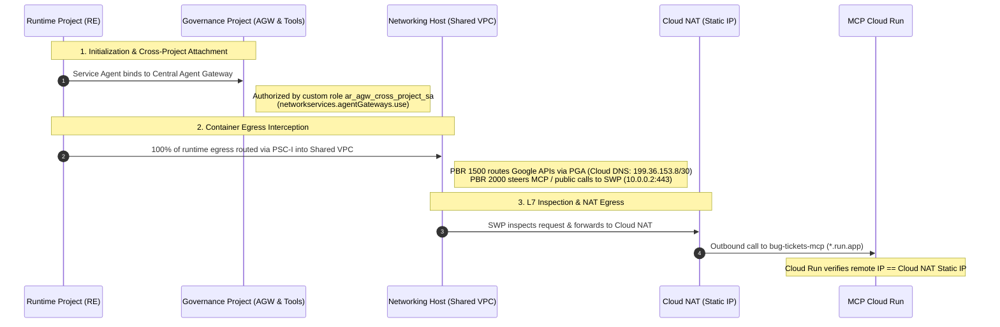

# Agent Gateway with Shared VPC & Dedicated Runtime Project (CUJ2 Multi-Project Extension)

This demo extends the **CUJ 2** egress governance architecture into a **Three-Project Enterprise Topology** using **Google Cloud Shared VPC** and cross-project **Vertex AI Agent Runtime (Reasoning Engine)** bindings.

In this enterprise architecture, responsibilities and access boundaries are decoupled across three dedicated Google Cloud projects:

1. **Networking Project (Host Project)**:
   - Owns centralized network infrastructure and security perimeter.
   - Hosts the **Shared VPC** (`google_compute_shared_vpc_host_project`) with both Governance and Runtime projects associated as service projects (`google_compute_shared_vpc_service_project`).
   - Hosts the VPC subnets:
     - Primary workload subnet (`10.0.0.0/20`)
     - Dedicated PSC-I subnet for Agent Gateway (`10.20.0.0/26`, `purpose = "PRIVATE_SERVICE_CONNECT"`)
     - Dedicated proxy-only subnet for Secure Web Proxy (`10.30.0.0/24`, `purpose = "REGIONAL_MANAGED_PROXY"`)
   - Hosts the **Secure Web Proxy (SWP)** in `NEXT_HOP_ROUTING_MODE`, security policies, and Policy-Based Routes (PBRs).
   - Hosts the **Cloud Router** and **Cloud NAT** with a reserved static external IP address.
   - Hosts the **Private Cloud DNS Zone** for `googleapis.com.` (Private Google Access routing).
   - Enforces VPC firewall rules.

2. **Governance Project (Service Project 1)**:
   - Owns centralized AI governance, policy control, and shared tools.
   - Hosts the **Agent Gateway** (`AGENT_TO_ANYWHERE`) and **Agent Connectivity Template** (`deployment_model = "CENTRALIZED"`).
   - Provisions the **PSC-I Network Attachment**, connected across projects to the Shared VPC subnet in the Host Project.
   - Hosts the **Agent Registry** endpoints and service catalog.
   - Hosts **Model Armor** templates (Request/Response guardrails, Prompt Injection / Jailbreak filters, RAI filters, and DLP inspection templates).
   - Hosts the **MCP Cloud Run** service (`bug-tickets-mcp`) and Artifact Registry repository.
   - Defines the custom IAM role `ar_agw_cross_project_sa` to authorize external Spoke / Runtime projects to attach to the Central Agent Gateway.

3. **Runtime Project (Service Project 2)**:
   - Dedicated to line-of-business AI agent deployment and execution.
   - Hosts the **Vertex AI Reasoning Engine** (`software-bug-agent`).
   - Hosts the agent staging Cloud Storage bucket.
   - Configures `agent_gateway_config` to bind all container egress to the Central Agent Gateway in the Governance Project.
   - Uses **Agent Identity** (SPIFFE `principalSet://...`) recognized across project boundaries by Governance Project policies (Agent Registry IAP egress and Model Armor guardrails).

---

## Architecture Diagram

```
┌────────────────────────────────────────────────────────────────────────┐
│  Runtime Project (Service Project 2: var.runtime_project_id)           │
│                                                                        │
│   Vertex AI Agent Engine (Reasoning Engine: software-bug-agent)        │
│     │                                                                  │
│     │ agent_gateway_config:                                            │
│     │   projects/{gov_project}/locations/{region}/agentGateways/agw    │
│     ▼ (Cross-Project Attachment via ar_agw_cross_project_sa)           │
└─────┼──────────────────────────────────────────────────────────────────┘
      │
      ▼
┌────────────────────────────────────────────────────────────────────────┐
│  Governance Project (Service Project 1: var.governance_project_id)     │
│                                                                        │
│   Central Agent Gateway (AGENT_TO_ANYWHERE)                            │
│     • Custom Role: ar_agw_cross_project_sa (allows Runtime RE attach)  │
│     • Model Armor Templates (RAI, PI/Jailbreak, DLP)                   │
│     • Agent Registry & IAP Egressor Policies                           │
│     │                                                                  │
│     │ AgentConnectivityTemplate (CENTRALIZED, ALL_TRAFFIC)             │
│     ▼                                                                  │
│   PSC-I Network Attachment (in Governance Project)                     │
│     │ (Attached via Shared VPC to Host Subnet)                         │
└─────┼──────────────────────────────────────────────────────────────────┘
      │
      ▼
┌────────────────────────────────────────────────────────────────────────┐
│  Networking Project (Host Project: var.networking_project_id)          │
│                                                                        │
│   Shared VPC Network                                                   │
│   └── Agent Gateway Subnet (10.20.0.0/26, purpose=PSC)                 │
│         │                                                              │
│         ├── PBR 1500: *.googleapis.com Bypass SWP                      │
│         │     → Cloud DNS (googleapis.com. → 199.36.153.8/30)          │
│         │     → Private Google Access (Google APIs)                    │
│         │                                                              │
│         └── PBR 2000: All Other Traffic Redirect to SWP                │
│               │                                                        │
│               ▼                                                        │
│         Secure Web Proxy (NEXT_HOP_ROUTING_MODE)                       │
│           • SWP Proxy-Only Subnet (10.30.0.0/24)                       │
│           • Gateway Security Policy (ALLOW all)                        │
│           • Anti-loop PBR 1000                                         │
│               │                                                        │
│               ▼                                                        │
│         Cloud Router → Cloud NAT (Static External IP)                  │
└───────────────┬────────────────────────────────────────────────────────┘
                │ Egress to Internet (Source IP = Cloud NAT Static IP)
                ▼
┌────────────────────────────────────────────────────────────────────────┐
│  Public Internet / Destination Endpoints                               │
│                                                                        │
│   Governance Project Cloud Run: bug-tickets-mcp (*.run.app)            │
│     (Logs verify inbound caller IP matches Cloud NAT Static IP)        │
└────────────────────────────────────────────────────────────────────────┘
```

---

## Cross-Project IAM Flow



---

## Prerequisites

1. **Three Google Cloud Projects**:
   - `networking_project_id`: Host project for Shared VPC, subnets, SWP, Cloud NAT, and DNS.
   - `governance_project_id`: Service project 1 for Central Agent Gateway, Registry, Model Armor, and MCP.
   - `runtime_project_id`: Service project 2 for Vertex AI Agent Runtime (Reasoning Engine) and staging storage.
   - The user deploying this demo must have **Owner** or **Editor + Network Admin** permissions on all three projects.
   - **Shared VPC Administration**: Enabling a project as a Shared VPC host project and attaching service projects requires `compute.organizations.enableXpnHost` and `compute.organizations.enableXpnResource` (`roles/compute.xpnAdmin` at the Organization or Folder level). If Shared VPC host enablement and service project attachments are pre-configured by an Org Admin, set `manage_shared_vpc = false` in `terraform.tfvars`.
2. **Tools Installed**:
   - `gcloud` CLI (authenticated via `gcloud auth login` and `gcloud auth application-default login`)
   - `terraform` (>= 1.12.2)
   - `python` (>= 3.11) with `uv` or `pip`
   - `curl` and `jq`

---

## Deployment Walkthrough

### Step 1: Configuration

In `demos/agent-gateway-shared-vpc-runtime/terraform/`:

```bash
cd demos/agent-gateway-shared-vpc-runtime/terraform

# Configure backend (optional, or use local state by omitting -backend-config)
cp example.backend.conf backend.conf
# Edit backend.conf with your GCS bucket name

# Configure variables
cp example.tfvars terraform.tfvars
```

Edit `terraform.tfvars`:
```hcl
governance_project_id = "my-gov-project"
networking_project_id = "my-net-project"
runtime_project_id    = "my-runtime-project"
organization_id       = "123456789012"
platform_admin_members = [
  "user:your-email@example.com"
]
region = "us-central1"
```

### Step 2: Initialize & Apply Phase 1 (Infrastructure, Shared VPC & Gateway)

Initialize Terraform:
```bash
terraform init -backend-config=backend.conf
```

Validate and plan:
```bash
terraform validate
terraform plan
```

Apply Phase 1:
```bash
terraform apply
```

This provisions:
- Foundation APIs on all 3 projects and Shared VPC linkage (Governance and Runtime attached to Networking Host).
- Cross-project IAM:
  - `roles/compute.networkUser` and `roles/dns.peer` on Host project for Governance and Runtime service agents.
  - Custom role `ar_agw_cross_project_sa` on Governance project for Runtime Vertex AI service agents.
- Shared VPC network, subnets, Cloud NAT with static IP, SWP, and Private DNS in Host project.
- Model Armor templates in Governance project.
- Artifact Registry and `bug-tickets-mcp` Cloud Run service in Governance project.
- PSC-I Network Attachment, Agent Connectivity Template, and Agent Gateway in Governance project.

### Step 3: Package Agent & Deploy Reasoning Engine (Phase 2)

1. Build the agent artifacts manifest targeting the **Runtime Project**:
```bash
cd ../src/software-bug-agent

# Set up environment
cp .env.example .env
# Edit .env with your runtime_project_id, region, and bug_tickets_mcp_url from terraform output

# Package the agent
uv run python deploy_agent.py \
  --project="$(cd ../../terraform && terraform output -raw runtime_project_id)" \
  --region="us-central1" \
  --build-only
```

2. Deploy the Reasoning Engine to the **Runtime Project** via Terraform:
```bash
cd ../../terraform
terraform apply -var="deploy_reasoning_engine=true"
```

---

## Verification & Testing

### 1. Verify Cross-Project Shared VPC & Network Attachment
Confirm that the Network Attachment in the Governance project references the Host project's PSC subnet:
```bash
gcloud compute network-attachments describe \
  $(terraform output -raw network_attachment_id | awk -F/ '{print $NF}') \
  --region=us-central1 \
  --project=$(terraform output -raw governance_project_id)
```

### 2. Verify Cross-Project IAM on Governance Project
Confirm that the Runtime project's Vertex AI service agent is granted the `ar_agw_cross_project_sa` role:
```bash
gcloud projects get-iam-policy $(terraform output -raw governance_project_id) \
  --flatten="bindings[].members" \
  --filter="bindings.role:roles/ar_agw_cross_project_sa"
```

### 3. Verify Agent Runtime Egress via SWP & Static IP
Run a test query against the Reasoning Engine deployed in the **Runtime Project**:
```bash
python3 -c "
import vertexai
from vertexai.preview import reasoning_engines

vertexai.init(project='$(terraform output -raw runtime_project_id)', location='us-central1')
agent = reasoning_engines.ReasoningEngine('$(terraform output -raw reasoning_engine_id)')
response = agent.query(input='List the latest open bug tickets')
print(response)
"
```

Check the Cloud Run logs in the Governance project to confirm the request originated from the Cloud NAT static IP:
```bash
gcloud logging read 'resource.type="cloud_run_revision" AND textPayload:"bug-tickets-mcp"' \
  --project=$(terraform output -raw governance_project_id) \
  --limit=5 \
  --format="value(httpRequest.remoteIp)"
```
The IP must match `terraform output -raw nat_static_ip`.

---

## Clean Up / Destruction

To delete all resources in order:

```bash
cd demos/agent-gateway-shared-vpc-runtime/terraform

# Destroy all resources across the three projects
terraform destroy
```
