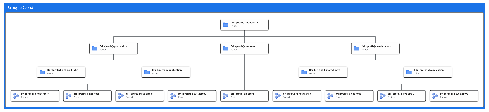
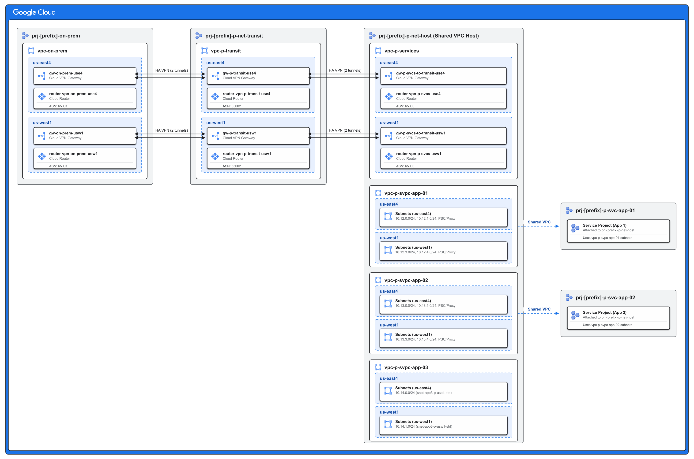

# Google Cloud Networking Lab

This repository provides Terraform code that you can use to deploy and experiment with various Google Cloud networking patterns; for example: **Network Connectivity Center (NCC)** (`examples/ncc`) and **Hub-and-Spoke VPC Network Peering** (`examples/vpc-peering`).

Instead of building your VPCs, VPNs, and foundational hierarchy from scratch every time you want to test a network design, you can use this reusable code as your starting point.

### Based on Google Cloud Architecture Blueprints

The networking patterns and foundational hierarchies deployed by this code are based on designs published in the **Google Cloud Architecture Center**:
* **[Cross-Cloud Network inter-VPC connectivity using Network Connectivity Center](https://cloud.google.com/architecture/ccn-distributed-apps-design/ccn-ncc-vpn-ra)**: Centralized hub-and-spoke routing, hybrid VPN attachments, and dynamic BGP route exchanges.
* **[Cross-Cloud Network inter-VPC connectivity using VPC Network Peering](https://cloud.google.com/architecture/ccn-distributed-apps-design/ccn-vnp-vpn-ra)**: Hub-and-spoke VPC Network Peering with custom route import/export and HA VPN hybrid connectivity.
* **[Landing Zone Resource Hierarchy (Option 1)](https://cloud.google.com/architecture/landing-zones/decide-resource-hierarchy#option1)**: Environment structure (`production`, `development`, and `on-prem`) across Level 1–3 folders to isolate shared infrastructure from application workloads.
* **[Security Foundations Naming Conventions](https://cloud.google.com/architecture/blueprints/security-foundations/summary#naming-conventions)**: Consistent naming standards across folders (`fldr-*`), projects (`prj-*`), networks (`vpc-*`), and subnets (`snet-*`).

---

## Prerequisites & IAM Permissions

Before deploying any configuration in this repository, ensure you have the following prerequisites configured:

* **Terraform**: Version 1.5.0 or newer installed locally.
* **Google Cloud SDK**: `gcloud` CLI installed and authenticated (`gcloud auth application-default login`) or configured with a Service Account.
* **GCS State Bucket**: A Google Cloud Storage bucket to store your remote Terraform state files (`.tfstate`).
* **IAM Permissions**: Your authenticated principal must have the following roles granted at the Google Cloud Organization level (or on the top-level folder where the lab is deployed):
  * **Folder Admin** (`roles/resourcemanager.folderAdmin`) – To create and manage the folder hierarchy.
  * **Project Creator** (`roles/resourcemanager.projectCreator`) – To provision foundational and service projects.
  * **Project Deleter** (`roles/resourcemanager.projectDeleter`) – To cleanly destroy projects during lab teardowns.
  * **Shared VPC Admin** (`roles/compute.xpnAdmin`) – To enable Shared VPC host projects and associate service projects.
  * **Billing Account User** (`roles/billing.user`) – On your Cloud Billing account to link newly created projects.
  * **Organization Policy Admin** (`roles/orgpolicy.policyAdmin`) – *(Optional)* To relax organization policy constraints (e.g., VPN peer IPs) if enforced by your organization.
  * **Compute Network Admin / NCC Admin** (`roles/compute.networkAdmin`, `roles/networkconnectivity.admin`) – To manage VPCs, VPNs, global network firewall policies, and NCC resources.
  * **Compute Organization Security Policy & Resource Admin** (`roles/compute.orgSecurityPolicyAdmin`, `roles/compute.orgSecurityResourceAdmin`) – To create and attach the folder-level Hierarchical Firewall Policy.
  * **Tag Admin & Tag User** (`roles/resourcemanager.tagAdmin`, `roles/resourcemanager.tagUser`) – To create and bind `GCE_FIREWALL` Secure Tags across firewall policies and workloads.

---

## Resource Hierarchy

Regardless of which specific networking pattern (NCC, VPC Peering, etc.) you are deploying, the underlying **Resource Hierarchy** remains consistent across all lab scenarios. This structure isolates environments and enforces clean separation between network infrastructure and application workloads in accordance with the **[Landing Zone Resource Hierarchy (Option 1)](https://cloud.google.com/architecture/landing-zones/decide-resource-hierarchy#option1)** blueprint and **[Security Foundations Naming Conventions](https://cloud.google.com/architecture/blueprints/security-foundations/summary#naming-conventions)**.

### Folders Hierarchy

| Folder Name | Level | Parent Resource | Purpose & Scope |
| :--- | :--- | :--- | :--- |
| **`fldr-[prefix]-network-lab`** | Level 1 Folder | Organization (`var.organization_id`) | Root isolation folder containing all lab environments and policies. |
| **`fldr-[prefix]-on-prem`** | Level 2 Folder | `fldr-[prefix]-network-lab` | Contains simulated on-prem resources. |
| **`fldr-[prefix]-production`** | Level 2 Folder | `fldr-[prefix]-network-lab` | Contains production environment infrastructure and applications. |
| **`fldr-[prefix]-p-shared-infra`** | Level 3 Folder | `fldr-[prefix]-production` | Contains production core networking and shared infrastructure. |
| **`fldr-[prefix]-p-application`** | Level 3 Folder | `fldr-[prefix]-production` | Contains production application service projects. |
| **`fldr-[prefix]-development`** | Level 2 Folder | `fldr-[prefix]-network-lab` | Contains development environment infrastructure and applications. |
| **`fldr-[prefix]-d-shared-infra`** | Level 3 Folder | `fldr-[prefix]-development` | Contains development core networking and shared infrastructure. |
| **`fldr-[prefix]-d-application`** | Level 3 Folder | `fldr-[prefix]-development` | Contains development application service projects. |

### Projects Hierarchy

| Project Name | Parent Folder | Role / Network Type | Purpose & Scope |
| :--- | :--- | :--- | :--- |
| **`prj-[prefix]-on-prem`** | `fldr-[prefix]-on-prem` | Standalone Network | Hosts the simulated on-prem VPC (`vpc-on-prem`), subnets, and HA VPN gateways. |
| **`prj-[prefix]-p-net-host`** | `fldr-[prefix]-p-shared-infra` | Shared VPC Host | Hosts production shared networks and application Shared VPCs. |
| **`prj-[prefix]-p-net-transit`** | `fldr-[prefix]-p-shared-infra` | Central Routing Hub | Hosts `vpc-p-transit` and network overlays (such as NCC Hub or Transit routing). |
| **`prj-[prefix]-p-svc-app-01`** | `fldr-[prefix]-p-application` | Service Project | Attached to `prj-[prefix]-p-net-host` Shared VPC to host Application 1 workloads. |
| **`prj-[prefix]-p-svc-app-02`** | `fldr-[prefix]-p-application` | Service Project | Attached to `prj-[prefix]-p-net-host` Shared VPC to host Application 2 workloads. |
| **`prj-[prefix]-d-net-host`** | `fldr-[prefix]-d-shared-infra` | Shared VPC Host | Hosts development shared networks and development Shared VPCs. |
| **`prj-[prefix]-d-net-transit`** | `fldr-[prefix]-d-shared-infra` | Central Routing Hub | Hosts development central transit networks and routing overlays. |

> **Note:** `[prefix]` defaults to `lab` at the module level, **`ncc`** in [`examples/ncc`](examples/ncc), and **`peer`** in [`examples/vpc-peering`](examples/vpc-peering) so both example topologies can be deployed side-by-side in the same Google Cloud Organization without folder, project, or firewall tag collisions. Each provisioned project's GCP Project ID has a 4-character random hex suffix appended (such as `prj-ncc-p-net-host-a1b2`). The `development` folders and projects are provisioned in Stage 1 (`01-foundation`) as foundational placeholders for custom extensions, while Stage 2 (`02-networking`) deploys networking resources into `production` and `on-prem`. For detailed technical specifications, reference the [Foundation Module Documentation](modules/foundation/README.md).

---

## Networking Architecture

The base architecture defaults to two regions—**`us-east4`** (primary) and **`us-west1`** (secondary)—configurable via `var.regions`.

### 1. VPC Networks & Subnet Design

| VPC Network Name | Project | VPC Type / Purpose | Subnet Ranges & Features |
| :--- | :--- | :--- | :--- |
| **`vpc-on-prem`** | `prj-[prefix]-on-prem` | Simulated On-Premises | Client/Web subnets (`192.168.x.x/24`), plus **CGN** (`100.64.x.x/24`) and **PUPI** (`1.2.x.x/24`) ranges (enabled by default via `enable_on_prem_cgn` / `enable_on_prem_pupi`) across `us-east4` and `us-west1`. |
| **`vpc-p-transit`** | `prj-[prefix]-p-net-transit` | Central Routing Backbone | Transit routing subnets (`10.10.x.x/24`), Regional Managed Proxy subnets (`172.16.0.0/24`, `172.16.2.0/24`), and PSC NAT subnets (`172.16.1.0/24`, `172.16.3.0/24`) across `us-east4` and `us-west1`. |
| **`vpc-p-services`** | `prj-[prefix]-p-net-host` | Shared Services Network | Services management and tooling subnets (`10.11.x.x/24`) across `us-east4` and `us-west1`. |
| **`vpc-p-svpc-app-01`** | `prj-[prefix]-p-net-host` | Shared VPC (App 1) | Client/Web/PSC endpoints (`10.12.x.x/24`), plus **CGN** (`100.64.x.x/24`) and **PUPI** (`1.2.x.x/24`) ranges (enabled by default via `enable_prod_app1_cgn` / `enable_prod_app1_pupi`) across `us-east4` and `us-west1`. |
| **`vpc-p-svpc-app-02`** | `prj-[prefix]-p-net-host` | Shared VPC (App 2) | Client/Web/PSC (`10.13.x.x/24`), Regional Managed Proxy (`172.17.x.x/24`), plus **CGN** (`100.64.x.x/24`) and **PUPI** (`1.2.x.x/24`) ranges (enabled by default via `enable_prod_app2_cgn` / `enable_prod_app2_pupi`) across `us-east4` and `us-west1`. |
| **`vpc-p-svpc-app-03`** | `prj-[prefix]-p-net-host` | Shared VPC (App 3) | Standard subnets (`10.14.0.0/24` in `us-east4` and `10.14.1.0/24` in `us-west1`) used to demonstrate VPC isolation within an NCC mesh. |

* **Private Google Access**: Enabled by default (`subnet_private_access = "true"`) on all standard VM subnets across all 6 VPCs (base RFC 1918, CGN, and PUPI ranges), and automatically set to `"false"` on special-purpose `REGIONAL_MANAGED_PROXY` and `PRIVATE_SERVICE_CONNECT` subnets.
* **Firewall Policy Enforcement Order**: All 6 VPC networks are configured with `network_firewall_policy_enforcement_order = "BEFORE_CLASSIC_FIREWALL"` (customizable per VPC in `local.vpcs`).

> **Note:** For a comprehensive breakdown of specific subnet names, individual CIDR blocks, Proxy-only subnets, and PSC allocations across regions, reference the [Networking Module Documentation](modules/networking/README.md).

### 2. Hybrid Connectivity & Dynamic Routing (HA VPN & BGP)

| Connection / Routing Component | Endpoints Connected | Regions | BGP ASNs | Purpose |
| :--- | :--- | :--- | :--- | :--- |
| **On-Prem to Transit HA VPN** | `vpc-on-prem` ➔ `vpc-p-transit` | `us-east4` & `us-west1` | On-Prem: **ASN 65001** Transit: **ASN 65002** | Redundant site-to-site encrypted tunnels (8 tunnels across 4 HA VPN gateways) simulating hybrid cloud interconnectivity. |
| **Services to Transit HA VPN** | `vpc-p-services` ➔ `vpc-p-transit` | `us-east4` & `us-west1` | Services: **ASN 65003** Transit: **ASN 65002** | Redundant site-to-site encrypted tunnels (8 tunnels across 4 HA VPN gateways) connecting shared services to the transit backbone. |

### 3. Cloud NAT & Outbound Egress

Following Google Cloud best practices, **12 regional Cloud NAT gateways** are deployed on dedicated Cloud Routers (`<vpc_name>-nat-cr-<region>`, separate from the 6 HA VPN BGP Cloud Routers) across `us-east4` and `us-west1` for all 6 VPCs (`vpc-on-prem`, `vpc-p-transit`, `vpc-p-services`, `vpc-p-svpc-app-01`, `vpc-p-svpc-app-02`, and `vpc-p-svpc-app-03`). Each NAT gateway is configured with `ALL_SUBNETWORKS_ALL_IP_RANGES`, `min_ports_per_vm = 4096`, and `ERRORS_ONLY` logging.

### 4. Inter-VPC Connectivity: NCC Hub & Spokes (`enable_ncc`) or VPC Peering (`enable_vpc_peering`)

The base architecture supports two mutually exclusive inter-VPC connectivity patterns (validation enforces that `enable_ncc` and `enable_vpc_peering` cannot both be `true` at the same time):

* **Option A — Network Connectivity Center (NCC) Hub & Spokes (`var.enable_ncc = true`)**:
  A central **NCC Hub** (`ncc-hub-prod`) is provisioned in `prj-[prefix]-p-net-transit` with a `MESH` preset topology, Private Service Connect propagation enabled (`export_psc = true`), and auto-accept rules for the host and transit projects:
  * **4 VPC Spokes**: `spoke-p-vpc-transit`, `spoke-p-vpc-app1`, `spoke-p-vpc-app2`, and `spoke-p-vpc-app3`.
  * **4 Hybrid VPN Spokes**: `spoke-p-hybrid-vpn-onprem-use4`, `spoke-p-hybrid-vpn-onprem-usw1`, `spoke-p-hybrid-vpn-svcs-use4`, and `spoke-p-hybrid-vpn-svcs-usw1` (with `site_to_site_data_transfer = true`).
* **Option B — Hub-and-Spoke VPC Network Peering (`var.enable_vpc_peering = true`)**:
  Bidirectional VPC Network Peerings are created in [`vpc-peering.tf`](modules/networking/vpc-peering.tf) between `vpc-p-transit` and the three application VPCs (`vpc-p-svpc-app-01`, `vpc-p-svpc-app-02`, and `vpc-p-svpc-app-03`) with custom route exchange enabled (`export_custom_routes = true` and `import_custom_routes = true`) so HA VPN BGP routes are shared between `vpc-p-transit` and the application VPCs.

### 5. Firewall Policies & Secure Tags

The base architecture implements a layered firewall strategy using **Hierarchical Firewall Policies**, **Global Network Firewall Policies**, and **IAM Secure Tags (`GCE_FIREWALL`)**:
* **Firewall Secure Tags**: Organization-scoped `GCE_FIREWALL` tag keys (`[prefix]-quarantine` and `[prefix]-workload`) providing tag values for `quarantine`, `on-prem-webserver`, `on-prem-client`, `app1-webserver`, `app1-client`, `app2-webserver`, `app2-client`, `app3-webserver`, and `app3-client`.
* **Hierarchical Firewall Policy (`hfwp-[prefix]-network-lab`)**: Attached to the Level 1 base folder (`fldr-[prefix]-network-lab`) to enforce baseline guardrails across all environments—including immediate ingress/egress quarantine (`500`/`501`), Google Load Balancer and NLB health check/proxy ingress (`1000`/`2000`), IAP SSH/RDP access (`3000`), and Geo-location / Threat Intelligence ingress and egress blocks (`3100`–`3400`).
* **Per-VPC Global Network Firewall Policies (`gfwp-<vpc_name>`)**: Associated with each of the 6 VPC networks (`vpc-on-prem`, `vpc-p-transit`, `vpc-p-services`, `vpc-p-svpc-app-01`, `vpc-p-svpc-app-02`, and `vpc-p-svpc-app-03`) to govern workload-to-workload traffic using `src_secure_tags` and `target_secure_tags`, proxy-only and PSC NAT subnet ingress, and explicit logged `DENY` catch-all rules (`2000000000`). All 6 VPCs are configured with `network_firewall_policy_enforcement_order = "BEFORE_CLASSIC_FIREWALL"` (customizable per VPC in `local.vpcs`) so Global Network Firewall Policies are evaluated before any Classic VPC Firewall Rules.

---

## Examples

### 1. Network Connectivity Center (NCC) Mesh Topology (`examples/ncc`)

The **[NCC Hub & Spoke Example Template](examples/ncc)** demonstrates how to build a multi-region hub-and-spoke network on Google Cloud using [Network Connectivity Center (NCC)](https://cloud.google.com/network-connectivity/docs/network-connectivity-center/concepts/overview) (`enable_ncc = true`). This design is based on the [Cross-Cloud Network inter-VPC connectivity using Network Connectivity Center](https://cloud.google.com/architecture/ccn-distributed-apps-design/ccn-ncc-vpn-ra) reference architecture published in the Google Cloud Architecture Center.

In this example, an NCC Hub is deployed inside the central transit project (`prj-[prefix]-p-net-transit`) configured with a **MESH** preset topology. Production VPC networks (`transit`, `app1`, `app2`, `app3`) are connected as VPC spokes, while `on-prem` and `services` VPCs are connected via redundant Site-to-Site HA VPN hybrid spokes across `us-east4` and `us-west1`. Auto-acceptance rules automatically authorize and accept spokes originating from your host and transit projects into the mesh.

### 2. Hub-and-Spoke VPC Network Peering Topology (`examples/vpc-peering`)

The **[VPC Network Peering Example Template](examples/vpc-peering)** demonstrates how to deploy the same foundational hierarchy, VPCs, HA VPNs, and Firewall Policies using **VPC Network Peering** (`enable_vpc_peering = true`) instead of NCC. This design is based on the [Cross-Cloud Network inter-VPC connectivity using VPC Network Peering](https://cloud.google.com/architecture/ccn-distributed-apps-design/ccn-vnp-vpn-ra) reference architecture published in the Google Cloud Architecture Center.

Bidirectional peerings connect `vpc-p-transit` with `vpc-p-svpc-app-01`, `vpc-p-svpc-app-02`, and `vpc-p-svpc-app-03` with custom route import/export enabled so HA VPN BGP routes from `on-prem` and `services` are exchanged with the peered application VPCs.

---

## Deployment

You can deploy, verify, and tear down the network lab either through an AI agentic harness using the repository's built-in skill or manually using `terraform` and `gcloud` CLI commands.

### 1. Agentic Harness Deployment

This repository includes the **`deploy-network-lab`** agent skill ([`.agents/skills/deploy-network-lab/SKILL.md`](.agents/skills/deploy-network-lab/SKILL.md)). Open this repository in **Antigravity** (or any compatible AI agentic coding harness) and use natural-language prompts to trigger the **`deploy-network-lab`** skill across the full lifecycle of the lab:

* **Explore / Describe the Architecture**: Prompt *"Describe network lab"* — the agent will explain the repository's two-stage architecture, folder/project hierarchy, VPC and subnet layouts, HA VPNs, and NCC hub-and-spoke topology.
* **Check Prerequisites**: Prompt *"Check prerequisites"* — the agent will auto-discover or prompt for your GCP Project ID, Organization ID, Billing Account ID, and GCS state bucket, verify all required tools and IAM permissions, and provide copy-pasteable `gcloud` remediation commands if anything is missing.
* **Deploy the Lab**: Prompt *"Deploy network lab"* — the agent will copy the `examples/ncc` (or `examples/vpc-peering`) template into a dedicated lab folder (e.g., `examples/nwklab`), configure `backend.tf` and `terraform.tfvars`, review and apply Stage 1 (`01-foundation`), reset the `compute.restrictVpnPeerIPs` organization policy on the lab folder, and review and apply Stage 2 (`02-networking`).
* **Verify Connectivity**: Prompt *"Verify network lab"* — the agent will validate that all 16 HA VPN tunnels are `ESTABLISHED`, all 16 BGP sessions across the 6 VPN Cloud Routers are `Established` and exchanging routes, and all 8 NCC spokes (or all 6 VPC Network Peerings) are `ACTIVE`.
* **Teardown / Clean Up**: Prompt *"Teardown network lab"* — the agent will scan for and help clean up any teardown blockers (such as standalone VMs, manual firewall rules, or project liens) and destroy `02-networking` and `01-foundation` in reverse order.

### 2. Manual Deployment

If you prefer to deploy, verify, and tear down the lab manually using standard `terraform` and `gcloud` CLI commands, follow the step-by-step instructions in the **[NCC Lab Example Deployment Guide (`examples/ncc/README.md`)](examples/ncc/README.md)** or the **[VPC Peering Lab Example Deployment Guide (`examples/vpc-peering/README.md`)](examples/vpc-peering/README.md)**.

---

## Documentation & Reference Guides

For deeper technical specifications, variable definitions, and step-by-step walkthroughs, refer to the detailed READMEs included in each module and example:

* **[Foundation Module Documentation (`modules/foundation`)](modules/foundation/README.md)**: Detailed breakdown of folder hierarchies, project factory logic, Shared VPC enablement, organization policy resets, and API activations.
* **[Networking Module Documentation (`modules/networking`)](modules/networking/README.md)**: Comprehensive reference tables for subnet IP allocations, CGN/PUPI ranges, Cloud NAT specifications, VPN BGP peering sessions, Firewall Policies, and service project associations.
* **[NCC Hub & Spoke Example Deployment](examples/ncc/README.md)**: Step-by-step manual deployment instructions, verification commands, and teardown guides for the NCC topology (`enable_ncc = true`).
* **[VPC Network Peering Example Deployment](examples/vpc-peering/README.md)**: Step-by-step manual deployment instructions, verification commands, and teardown guides for the VPC Peering topology (`enable_vpc_peering = true`).
