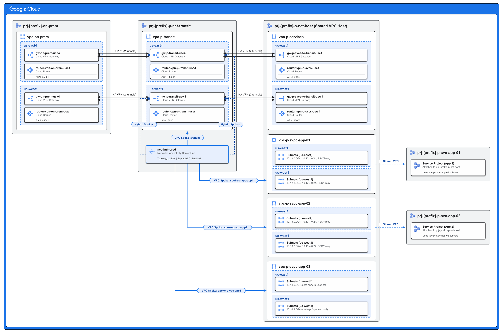

# Network Connectivity Center (NCC) Lab Example Deployment

This directory serves as the reusable **deployment template** for building an end-to-end hub-and-spoke network topology on Google Cloud using **Network Connectivity Center (NCC)** and Terraform.

To deploy a lab environment without modifying the version-controlled template files in-place, copy `examples/ncc` into a dedicated lab folder (e.g., `examples/nwklab`) where your user-provided inputs (`backend.tf` and `terraform.tfvars`) will be configured.

The deployment is split into two sequential stages:
1. **[01-foundation](01-foundation)**: Foundation hierarchy, projects, and Shared VPC enablement.
2. **[02-networking](02-networking)**: Core networking, VPCs, VPNs, Firewall Policies, and NCC Hub & Spokes.

For a complete breakdown of the resource hierarchy and networking specifications, see the **[Root Architecture Documentation (`README.md`)](../../README.md#resource-hierarchy)**.



---

## Prerequisites

Before deploying this example, ensure you have the following:
* **Terraform**: Version 1.5.0 or newer installed locally.
* **Google Cloud SDK**: `gcloud` CLI installed and authenticated with your user credentials (`gcloud auth application-default login`) or a Service Account.
* **IAM Permissions**: Your account must have sufficient permissions in your Google Cloud organization:
  * `roles/resourcemanager.folderAdmin` (Folder Admin / Creator)
  * `roles/resourcemanager.projectCreator` (Project Creator)
  * `roles/resourcemanager.projectDeleter` (Project Deleter)
  * `roles/compute.xpnAdmin` (Shared VPC Admin)
  * `roles/compute.networkAdmin` (Compute Network Admin)
  * `roles/compute.orgSecurityPolicyAdmin` (Compute Organization Security Policy Admin)
  * `roles/compute.orgSecurityResourceAdmin` (Compute Organization Resource Admin)
  * `roles/resourcemanager.tagAdmin` and `roles/resourcemanager.tagUser` (Tag Admin & Tag User for `GCE_FIREWALL` Secure Tags)
  * `roles/networkconnectivity.admin` (Network Connectivity Center Admin)
  * `roles/billing.user` (Billing Account User)
  * `roles/orgpolicy.policyAdmin` (Organization Policy Administrator - optional for policy overrides)
* **GCS State Bucket**: A Google Cloud Storage bucket to store your remote Terraform state files. If you do not have one yet, create one using `gcloud`:
  ```bash
  gcloud storage buckets create gs://YOUR_TF_STATE_BUCKET_NAME \
    --project=YOUR_SEED_PROJECT_ID \
    --location=us-east4 \
    --uniform-bucket-level-access
  ```

> **Tip — Service Account Impersonation:** If your organization requires deploying via a privileged Service Account rather than user credentials, export `GOOGLE_IMPERSONATE_SERVICE_ACCOUNT="<SERVICE_ACCOUNT_EMAIL>"` (or prefix your `terraform` commands with `GOOGLE_IMPERSONATE_SERVICE_ACCOUNT=<SERVICE_ACCOUNT_EMAIL>`).

---

## Deployment Workflow

> **Automated Agentic Deployment:** Instead of running the manual commands below, you can deploy, verify, and tear down this lab automatically using the **`deploy-network-lab`** skill in **Antigravity** (or any compatible AI agentic coding harness). See **[Agentic Harness Deployment (`README.md`)](../../README.md#1-agentic-harness-deployment)** for details and example prompts.

For **manual deployment**, all commands below are designed to be run directly from the **repository root** using `terraform -chdir=...` so you never lose track of your working directory. You **must** deploy the stages in order: `01-foundation` first, followed by `02-networking`.

### Step 0: Initialize Lab Directory from Template

From the **repository root**, choose a name for your lab instance (e.g., `nwklab`) and copy the `examples/ncc` template into `examples/${LAB_NAME}`:

```bash
export LAB_NAME="nwklab"
mkdir -p examples/${LAB_NAME} && cp -r examples/ncc/. examples/${LAB_NAME}/
```

---

### Stage 1: Core Foundation (`01-foundation`)

The `01-foundation` configuration creates the hierarchical folder structure under your Google Cloud organization, deploys the foundational GCP projects (`prod-host`, `prod-transit`, `dev-host`, `dev-transit`, and `on-prem`), links them to your Cloud Billing account, enables required APIs, and sets up Shared VPC host projects (~55 resources).

1. **Configure the GCS Backend**: Open `examples/${LAB_NAME}/01-foundation/backend.tf` and update the `bucket` and lab-namespaced `prefix` parameters:
   ```hcl
   terraform {
     backend "gcs" {
       bucket = "YOUR_TF_STATE_BUCKET_NAME"
       prefix = "nwklab/foundation" # Use <lab_name>/foundation to avoid state collisions
     }
   }
   ```
2. **Create a `terraform.tfvars` file** in `examples/${LAB_NAME}/01-foundation/terraform.tfvars`:
   ```hcl
   organization_id    = "YOUR_ORGANIZATION_ID"
   billing_account_id = "YOUR_BILLING_ACCOUNT_ID"
   prefix             = "ncc" # Optional naming prefix (defaults to "ncc")
   ```
3. **Initialize, Plan, and Apply**:
   ```bash
   terraform -chdir=examples/${LAB_NAME}/01-foundation init
   terraform -chdir=examples/${LAB_NAME}/01-foundation plan
   terraform -chdir=examples/${LAB_NAME}/01-foundation apply
   ```
4. **Configure Organization Policies**: If your organization restricts public VPN peer IPs (`compute.restrictVpnPeerIPs`), run the `gcloud` command generated by the `org_policy_reset_command` Terraform output to reset the constraint on your newly created base architecture folder:
   ```bash
   $(terraform -chdir=examples/${LAB_NAME}/01-foundation output -raw org_policy_reset_command)
   ```

> **Important:** Organization policy resets take **30–60 seconds** to propagate across Google Cloud. Wait ~30–60 seconds after resetting `compute.restrictVpnPeerIPs` before applying `02-networking` so HA VPN tunnel creation does not hit a constraint violation.

---

### Stage 2: Networking (`02-networking`)

Once `01-foundation` is deployed, the `02-networking` configuration dynamically discovers the generated folders and projects. It deploys the production and on-prem VPC networks (with `BEFORE_CLASSIC_FIREWALL` policy evaluation order), subnets (with Private Google Access enabled on all standard VM subnets), Cloud NAT/Routers, HA VPN gateways and tunnels with BGP routing, a folder-level Hierarchical Firewall Policy (`hfwp-[prefix]-network-lab`), per-VPC Global Network Firewall Policies (`gfwp-<vpc_name>`) with `GCE_FIREWALL` Secure Tags, and configures the **Network Connectivity Center (NCC)** Hub and Spokes (~224 resources) using the official [terraform-google-modules/network-connectivity-center](https://github.com/terraform-google-modules/terraform-google-network/tree/main/modules/network-connectivity-center) module.

1. **Configure the GCS Backend**: Open `examples/${LAB_NAME}/02-networking/backend.tf` and update the `bucket` and lab-namespaced `prefix` parameters:
   ```hcl
   terraform {
     backend "gcs" {
       bucket = "YOUR_TF_STATE_BUCKET_NAME"
       prefix = "nwklab/networking" # Use <lab_name>/networking to avoid state collisions
     }
   }
   ```
2. **Create a `terraform.tfvars` file** in `examples/${LAB_NAME}/02-networking/terraform.tfvars`:
   ```hcl
   organization_id    = "YOUR_ORGANIZATION_ID"
   billing_account_id = "YOUR_BILLING_ACCOUNT_ID"
   prefix             = "ncc" # Must match the prefix used in 01-foundation (defaults to "ncc")
   ```
3. **Initialize, Plan, and Apply**:
   ```bash
   terraform -chdir=examples/${LAB_NAME}/02-networking init
   terraform -chdir=examples/${LAB_NAME}/02-networking plan
   terraform -chdir=examples/${LAB_NAME}/02-networking apply
   ```

> **Note:**
> * **NCC Auto-Acceptance**: The NCC module in `02-networking` is configured with a `MESH` topology and automatically includes your Shared VPC host project and transit project in the default group's `auto_accept_projects` list. All VPC spokes (`app1`, `app2`, `app3`, and `transit`) and Hybrid VPN spokes are automatically linked and accepted into the NCC mesh.
> * **Transient Cloud Router Errors**: When creating or removing multiple BGP peers concurrently on a Cloud Router, the Google Cloud API may occasionally return a transient `resourceNotReady` error. If this occurs during `apply` or `destroy`, simply re-run the command.

---

## Verification

After `02-networking` completes, retrieve the generated project IDs (which include a 4-character random suffix) and verify that the HA VPN tunnels are `ESTABLISHED`, BGP sessions on the `router-vpn-*` Cloud Routers are `Established`, and NCC spokes are `ACTIVE`:

```bash
# Retrieve the generated project IDs for on-prem, transit, host, and service projects
terraform -chdir=examples/${LAB_NAME}/02-networking output project_ids

# List NCC spokes in the transit and Shared VPC host projects
gcloud network-connectivity spokes list --project <TRANSIT_PROJECT_ID>
gcloud network-connectivity spokes list --project <HOST_PROJECT_ID>

# Check HA VPN tunnel status
gcloud compute vpn-tunnels list --project <TRANSIT_PROJECT_ID>
gcloud compute vpn-tunnels list --project <ON_PREM_PROJECT_ID>
gcloud compute vpn-tunnels list --project <HOST_PROJECT_ID>

# Check BGP peer status and learned routes on a VPN Cloud Router
gcloud compute routers get-status router-vpn-p-transit-use4 \
  --region us-east4 \
  --project <TRANSIT_PROJECT_ID>
```

---

## Clean Up / Teardown

To destroy the lab environment and avoid incurring further cloud costs, remove any manual resources (such as test VMs or firewall rules) created outside of Terraform and destroy the infrastructure in **reverse order**:

1. **Destroy Networking**:
   ```bash
   terraform -chdir=examples/${LAB_NAME}/02-networking destroy
   ```

2. **Destroy Foundation**:
   ```bash
   terraform -chdir=examples/${LAB_NAME}/01-foundation destroy
   ```

3. **Remove Remote State & Local Lab Directory** *(Optional)*:
   ```bash
   gcloud storage rm --recursive gs://YOUR_TF_STATE_BUCKET_NAME/${LAB_NAME}/
   rm -rf examples/${LAB_NAME}
   ```
